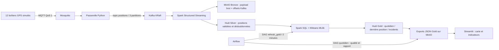

# FleetPulse — ISSE-05 : suivi de flotte de véhicules

Projet pédagogique Big Data de la filière **ISSE** (nom utilisé dans le PDF fourni).
GPS simulés à Casablanca, transport MQTT et Kafka, lakehouse Hudi, traitements Spark,
orchestration Airflow et tableau de bord Streamlit.

## Démarrage sur votre PC

Prérequis : Git, Docker Engine avec Compose v2 (Linux) ou Docker Desktop démarré
(Windows/macOS). Sur Windows, activer WSL2. Prévoir **au moins 16 Go de RAM sur le PC**,
8 Go attribués à Docker et 25 Go de disque libre. Internet requis pour images et paquets Maven.
Ces ressources sont des recommandations, pas un benchmark mesuré.

```bash
git clone https://github.com/HamidZemrour/Suivi-de-flotte-de-v-hicules-.git
cd Suivi-de-flotte-de-v-hicules-
docker compose up --build -d
```

Avec le ZIP : extraire entièrement le dossier, ouvrir un terminal dans le dossier
contenant `docker-compose.yml`, puis exécuter la dernière commande.
Le premier démarrage peut être long. Aucun jeu de données à télécharger.

| Interface | Adresse locale | Connexion de démonstration |
|---|---|---|
| Streamlit | http://localhost:8501 | aucune |
| Airflow | http://localhost:8080 | admin / admin |
| MinIO | http://localhost:9001 | fleetadmin / fleetpassword123 |

Attendre la fin du premier DAG `refresh_gold` (planifié toutes les 2 minutes).
Le tableau de bord présente un message d'attente tant qu'aucun export Gold n'existe.
Les vitesses sont simulées, la limite de 80 km/h est une règle du projet, pas une
cartographie des limitations routières réelles. Les coordonnées représentent une zone
rectangulaire de démonstration à Casablanca.

## Architecture



Le flux MQTT/Kafka/Silver est continu. La carte et les indicateurs sont actualisés
après chaque traitement Gold (micro-lot streaming : 20 s ; DAG Gold : toutes les 2 min).
Il s'agit de quasi temps réel et non d'une garantie de latence.

## Où se trouve le code ?

- `app/simulator.py` : 12 véhicules, positions GPS, arrêts et dépassements simulés.
- `app/bridge.py` : MQTT → Kafka, clé de partition = identifiant véhicule.
- `jobs/stream.py` : Kafka → Bronze, quarantaine, validation et Hudi Silver.
- `jobs/common.py` : configuration Spark/S3A et upserts Hudi Copy-on-Write.
- `jobs/analytics.py` : distance de Haversine, SQL journalier, zones d'arrêt KMeans, Gold et exports.
- `jobs/runner.py` : service HTTP interne permettant à Airflow de lancer Spark.
- `dags/refresh_gold.py` : orchestration des agrégats et réentraînement KMeans.
- `dags/daily_report.py` : contrôle de fraîcheur, qualité et rapport quotidien.
- `app/dashboard.py` : carte, incidents, zones d'arrêt, téléchargement CSV.
- `docs/` : cahier des charges, rapport, présentation et guide de soutenance.

## Contrat des données

Topic MQTT `fleet/positions` → topic Kafka `positions`.

```json
{"event_id":"uuid","vehicle_id":"VEH-001","event_ms":1735689600000,
 "latitude":33.58,"longitude":-7.60,"speed_kmh":85.0}
```

`event_ms` est un instant UTC en millisecondes. `event_id` est conservé lors du transport.
Les doublons de livraison sont absorbés par la clé Hudi `event_id` ; la dernière version
est choisie par `event_ms`. La validation contrôle les identifiants, l'horodatage positif,
les coordonnées et la vitesse entre 0 et 220 km/h. Les invalides vont en quarantaine.
Bronze conserve la chaîne JSON d'origine et les coordonnées Kafka.

| Zone | Chemin MinIO dans le bucket fleet | Format / clé |
|---|---|---|
| Bronze | bronze/batch=N | Parquet contenant le payload brut et offsets |
| Rejets | quarantine/batch=N | JSON |
| Silver | silver_positions | Hudi COW / event_id / day |
| Gold | gold_daily | Hudi COW / vehicle_id,day / day |
| Gold | gold_latest | Hudi COW / vehicle_id / day, index global |
| Gold | gold_incidents | Hudi COW / event_id / day |
| Modèle | models/stops | modèle KMeans MLlib |
| Restitution | exports | snapshots JSON issus de Gold |
| Rapport | reports/YYYY-MM-DD.json | rapport Airflow, jour UTC |

Le checkpoint streaming et les données sont persistés dans MinIO. Ne pas supprimer un
checkpoint en conservant les anciens dossiers Bronze `batch=N` : les numéros de lots
repartiraient de zéro. Pour une remise à zéro complète, utiliser la procédure ci-dessous.

## Mesures et modèle

Distance = somme des distances de Haversine entre points consécutifs par véhicule.
Un intervalle supérieur à 5 minutes ne contribue pas à la distance (trou GPS).
Cette distance échantillonnée sous-estime les parcours courbes. Les « incidents » sont
comptés en **mesures**, pas en épisodes : dix points en excès ne signifient pas dix trajets.

Excès : vitesse > 80 km/h. Géorepérage : latitude hors [33.50,33.66] ou longitude hors
[-7.72,-7.48]. Les points à vitesse ≤ 5 km/h alimentent KMeans (2 ou 3 zones selon le
nombre de points distincts). Les coordonnées sont projetées approximativement en km
pour Casablanca. Le modèle n'est pas entraîné si moins de 2 points distincts existent.
Il découvre des regroupements d'arrêts ; il ne prédit ni panne ni comportement dangereux.

## Vérifications et démonstration

```bash
python -m unittest discover -s tests -v
python -m compileall -q app jobs dags
# Recette Spark facultative hors Docker : installer pyspark==3.5.3 et Java 17
python tests/spark_smoke.py
docker compose config -q
docker compose ps
docker compose logs --tail=100 spark-stream spark-batch airflow
```

1. Vérifier `positions` :
   `docker compose exec kafka /opt/kafka/bin/kafka-console-consumer.sh --bootstrap-server kafka:9092 --topic positions --max-messages 3`.
2. Dans MinIO, vérifier Bronze, Silver et Gold et les répertoires `.hoodie` des tables.
3. Dans Airflow, vérifier le succès de `refresh_gold`, puis déclencher manuellement
   `daily_driving_report`. Le rapport concerne l'intervalle UTC du DAG ; il peut être vide
   si aucune donnée de cette date n'a été produite. Cela est explicite dans `vehicles`.
4. Dans Streamlit, montrer la carte, le véhicule hors zone, les excès et le CSV.
5. Vérifier le modèle dans `models/stops` après assez de mesures à l'arrêt.

Arrêter en conservant les données : `docker compose down`.
**Effacer uniquement les données de cette démonstration** : `docker compose down -v`.

## État de validation — à lire avant la soutenance

Les tests unitaires de distance/validation/alertes et la validation Compose passent.
Le code Python compile. La recette Spark locale (qualité, doublons, distance, SQL et KMeans) passe aussi. Un test Hudi local confirme les upserts sans doublon. La construction complète a été tentée dans l'environnement
cloud mais s'est arrêtée par manque d'espace disque. **La chaîne Docker complète n'est
pas validée de bout en bout à ce stade**. Aucun résultat de performance ou de modèle
n'est inventé. Voir `docs/VALIDATION.md` et compléter après exécution locale.

## Équipe et conformité au sujet

Le PDF impose 4 étudiants de la même filière, un dépôt commun et les contributions
réelles de chacun avec son compte. Compléter `docs/EQUIPE.md` et suivre la matrice
`docs/CONFORMITE.md`. Ne pas attribuer de faux commits aux autres membres.
Les documents sont des livrables de départ à personnaliser avec votre travail,
les captures de l'exécution et les résultats réellement observés.

## Limites

Environnement local pédagogique : comptes de démonstration, MQTT anonyme et Kafka
sans authentification, interfaces publiées uniquement sur localhost. Ne pas exposer sur
Internet tel quel. Un seul broker, pas de haute disponibilité. Les agrégats relisent tout
Silver et les exports sont collectés au driver : adaptés à la démo, à revoir pour une
flotte massive (fenêtres incrémentales, pagination, moteur SQL). Bronze et checkpoints
ne sont pas une transaction unique avec Hudi ; les reprises utilisent les mêmes clés
et chemins, mais une garantie exactly-once globale n'est pas revendiquée.
